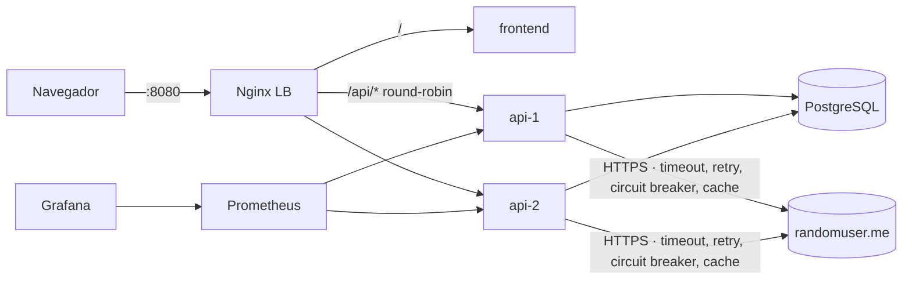
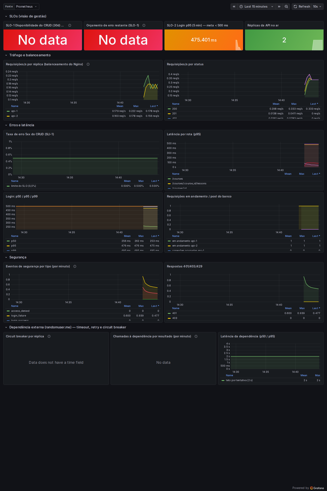

# CourseSphere — Desafio AppSec & SRE

[](https://github.com/soninhoxs/Desafio_Tecnico_AppSec---DEVOPS/actions/workflows/ci.yml)
[](https://github.com/soninhoxs/Desafio_Tecnico_AppSec---DEVOPS/actions/workflows/security.yml)
[](https://github.com/soninhoxs/Desafio_Tecnico_AppSec---DEVOPS/actions/workflows/e2e.yml)
[](https://github.com/soninhoxs/Desafio_Tecnico_AppSec---DEVOPS/actions/workflows/cd.yml)

Análise de segurança, correções, hardening, observabilidade e infraestrutura (Docker, Kubernetes, Terraform, GitOps) da aplicação **CourseSphere** (Ruby on Rails 8.1 + React 19, gestão de cursos e aulas).

> A aplicação original é de [PauloV1/CourseSphere-Full-Stack](https://github.com/PauloV1/CourseSphere-Full-Stack) (licença MIT). O histórico original foi preservado, e a versão analisada está na tag **`v0-original`**. Todas as mudanças deste trabalho vêm depois dela, em commits separados por assunto.

## Resultado em 30 segundos

| | |
|---|---|
| **Vulnerabilidades encontradas** | **9** (3 Altas, 4 Médias, 2 Baixas no contexto) — todas **corrigidas**, com testes automatizados e PoC |
| **Dependências vulneráveis** | gems: **30 → 0** · npm: **14 → 0** |
| **Hardening** | rate limit em 3 camadas, CSP/HSTS e outros headers, JWT endurecido com revogação, containers non-root/read-only, Pod Security, NetworkPolicies, Kyverno, imagens assinadas |
| **Confiabilidade** | Nginx balanceando **2 réplicas** da API, health checks, logs JSON, métricas Prometheus, **3 SLOs** com alertas de burn rate, dashboard Grafana, runbooks · dependência externa com **timeout, retry, circuit breaker, cache e fallback** |
| **Plataforma** | **Terraform** cria cluster kind + **ArgoCD** (app-of-apps) · pipeline **CI/CD** com SAST/SCA/DAST e deploy GitOps |
| **Evidências** | resultados **reais** do CI versionados em [`docs/evidencias/execucao/`](docs/evidencias/execucao/): PoC original × corrigido, balanceamento por réplica, exercício de falha, ZAP e **prints** da aplicação e do Grafana |

📄 **Relatório completo (pentest + confiabilidade):** [`docs/RELATORIO.md`](docs/RELATORIO.md)
🧭 Modelagem de ameaças (STRIDE + DFD): [`docs/threat-model.md`](docs/threat-model.md) · 📈 SLOs e observabilidade: [`docs/observabilidade.md`](docs/observabilidade.md) · 🧯 Runbooks: [`docs/runbooks/`](docs/runbooks/) · 🔐 Política de segurança: [`SECURITY.md`](SECURITY.md) · ✅ Verificação passo a passo: [`docs/VERIFICACAO.md`](docs/VERIFICACAO.md)

| ID | Vulnerabilidade | Severidade | Correção |
|---|---|---|---|
| VULN-04 | Credenciais padrão (`password123`) criadas em qualquer ambiente | Alta | `476f0c5` |
| VULN-05 | Aplicação publicada em modo de desenvolvimento (stack traces, `/rails/info`, Vite dev) | Alta | `19b1aed` |
| VULN-03 | Sem proteção contra força bruta no login | Alta | `fd20df1` |
| VULN-07 | Dependências com CVEs conhecidas (30 gems, 14 npm) | Média | `dc94e81` |
| VULN-01 | Aulas em rascunho visíveis para qualquer usuário (controle de acesso) | Média | `06cdccf` |
| VULN-02 | Logout não invalida o JWT | Média | `16ce453` |
| VULN-09 | Política de senha fraca (`123456` aceita) | Média | `b3859fd` |
| VULN-06 | `video_url` aceita `javascript:` (XSS armazenado latente) | Baixa | `0994800` |
| VULN-08 | Tempo do login revela e-mails cadastrados | Baixa | `ae89af9` |

---

## O que mudou nesta revisão

Revisão feita item a item contra o edital do desafio. O que faltava ou estava fraco:

| Melhoria | Item do edital atendido | Onde |
|---|---|---|
| **Evidências reais publicadas no repositório.** A cada push na `main` que passa no E2E, o CI grava em `docs/evidencias/execucao/` o PoC da versão original × corrigida (requisição → resposta), a distribuição do balanceador por réplica, o log JSON do Nginx, métricas do Prometheus, o exercício de falha, o resumo do OWASP ZAP e **prints** da aplicação e do dashboard. Antes isso existia só como artefato do Actions, que exige login e expira em 90 dias. Tokens JWT são removidos antes do commit. | 5 ("print ou log mostrando requests atendidas por instâncias diferentes"), 6 (evidências: prints, logs, requests/responses), reprodutibilidade | [`docs/evidencias/execucao/`](docs/evidencias/execucao/), `.github/workflows/e2e.yml` (job `publish`), `scripts/ci/` |
| **Tratamento de falhas na dependência externa.** O card "Instrutor convidado" chamava a `randomuser.me` direto do navegador, sem proteção. Agora a chamada passa pela API com timeout curto (teto de 2 s por tentativa), retry com backoff + jitter só para erro transitório (orçamento de 3 s), **circuit breaker** (abre com 5 falhas, testa a cada 30 s), cache de 24 h e fallback (a página continua funcionando). | Diferencial: "tratamento de falhas (timeout, retry, circuit breaker)" | `backend/app/services/`, `GET /api/courses/:id/guest_instructor`, [runbook](docs/runbooks/dependencia-externa.md) |
| **Observabilidade da dependência:** métricas de chamadas, latência e estado do disjuntor, linha nova no dashboard, alertas `ExternalDependencyCircuitOpen`/`ExternalDependencyFailing` e exercício de falha (`script/resilience_drill.rb`) que roda dentro do container no E2E. | 4 (métricas, dashboard) | `backend/lib/observability/metrics.rb`, `deploy/observability/` |
| **Segurança da mudança:** URL fixa (sem SSRF), resposta reduzida a nome/e-mail/foto, CSP `connect-src 'self'` (o JavaScript do navegador não chama mais terceiros; só a foto ainda vem da `randomuser.me`) e NetworkPolicy que libera só HTTPS para a internet, bloqueando redes privadas e o endereço de metadados da nuvem. | 3 (hardening) | `guest_instructor_client.rb`, `frontend/nginx/security-headers.conf`, `deploy/k8s/base/network-policies.yaml` |
| **Política de segurança (`SECURITY.md`).** A aba Security do GitHub indicava "No security policy detected". Agora define canal privado de reporte, prazos por severidade e regras para testes. | Postura de segurança | [`SECURITY.md`](SECURITY.md) |
| **Alerta do Code scanning fechado.** A regra Semgrep de regex de URI passou a valer só para `backend/`: o script de evidência da VULN-06 usa a regex antiga de propósito. | 7 (SAST no repositório) | `security/semgrep/coursesphere.yml` |
| **19 testes novos** (circuit breaker, cliente da dependência com transporte falso, endpoint). | Diferencial: testes automatizados | `backend/test/services/`, `backend/test/controllers/guest_instructors_controller_test.rb` |

**O que o próprio pipeline pegou** (e foi corrigido) desde a primeira execução no GitHub. É a evidência de que os gates funcionam:

- O **gate do Trivy na imagem** reprovou o deploy por **CVE-2026-33210 (CRITICAL)** na gem `json` 2.18.0 que vem *dentro* do Ruby 4.0.9. O lockfile já usava a versão corrigida, mas a gem padrão continuava na imagem. Também pegou pacotes do sistema operacional com correção publicada depois da tag da imagem base (resolvido com `apt-get upgrade`/`apk upgrade` no build).
- O **E2E** pegou três falhas que só aparecem em produção: um initializer chamava um logger que a API não carrega (`NameError` no boot), o `tmpfs` nascia `root:755` e o processo (uid 10001) não criava `tmp/pids`, e o healthcheck usava `wget` numa imagem que só tem `curl`.
- O **CI** pegou divergência entre as migrations e o `db/schema.rb`, e a falta da biblioteca `active_job` no eager load do Solid Cache.
- O **Trivy config** levou a: namespace explícito nos workloads, frontend com uid > 10000 e `Host` fixo no proxy (o cliente não escolhe mais o cabeçalho que a API recebe).

Detalhes e como reproduzir cada verificação: [`docs/VERIFICACAO.md`](docs/VERIFICACAO.md).

---

## Arquitetura



## Como rodar (ambiente isolado com Docker)

**Pré-requisitos:** Docker com Compose v2 (Docker Desktop no Windows/macOS) e Python 3.9+ (só para os scripts auxiliares, sem dependências).

```bash
git clone <este-repositório> && cd coursesphere
python scripts/bootstrap_env.py      # gera .env com segredos aleatórios (não vai para o Git)
docker compose up -d --build
python scripts/wait_for_http.py http://localhost:8080/api/health
```

| Serviço | URL |
|---|---|
| Aplicação | http://localhost:8080 |
| API (via balanceador) | http://localhost:8080/api/health |
| Grafana (dashboard já provisionado) | http://localhost:3001 — usuário `admin`, senha impressa pelo `bootstrap_env.py` |
| Prometheus | http://localhost:9090 |
| Alertmanager | http://localhost:9093 |

Usuários de demonstração: `tech@coursesphere.com` e `design@coursesphere.com`, com a senha `DEMO_USER_PASSWORD` do `.env`. Não existe mais senha padrão. Também dá para criar uma conta nova pela tela de cadastro.

Para parar: `docker compose down` (com `-v` apaga também os dados).

### Demonstrar o balanceamento entre as 2 réplicas

```bash
python scripts/lb_demo.py -n 20
```
```
  #01 status=200 x-served-by=api-1    body.instance=api-1
  #02 status=200 x-served-by=api-2    body.instance=api-2
  ...
Distribuição:
  api-1     10 req  ##########
  api-2     10 req  ##########
```
A mesma evidência aparece no log JSON do balanceador (`docker compose logs lb`, campo `upstream`) e no painel **"Requisições/s por réplica"** do Grafana.

### Demonstrar o tratamento de falhas (circuit breaker)

```bash
docker compose exec -T api-1 bin/rails runner script/resilience_drill.rb
```

O exercício chama a `randomuser.me` de verdade (a segunda chamada vem do cache). Depois simula a dependência **fora do ar** (um IP que não responde): cada requisição fica limitada ao orçamento de tempo até o disjuntor abrir, e daí em diante a resposta é **imediata**, com fallback. Assim as threads da API não ficam presas esperando timeout. O resultado da última execução no CI está em [`docs/evidencias/execucao/`](docs/evidencias/execucao/). O exercício roda num processo à parte, com disjuntor próprio, e não interfere nas réplicas que atendem o tráfego. Com tráfego real, a linha **"Dependência externa"** do Grafana mostra o estado do disjuntor de cada réplica.

---

## Como reproduzir os achados

O script `security/poc/poc.py` (só biblioteca padrão do Python) testa cada vulnerabilidade, cria os próprios usuários e mostra **VULNERÁVEL** ou **CORRIGIDO** com a requisição/resposta que comprova.

**1. Versão original (vulnerável)** — em uma cópia separada, sem mexer na `main`:
```bash
git worktree add ../coursesphere-original v0-original
cd ../coursesphere-original && docker compose up -d --build   # compose ORIGINAL (API em :3000)
cd -                                                           # volta para a main
python scripts/wait_for_http.py http://localhost:3000/courses --status 401 --timeout 600
python security/poc/poc.py --base-url http://localhost:3000
(cd ../coursesphere-original && docker compose down -v) && git worktree remove ../coursesphere-original
```

**2. Versão corrigida**
```bash
docker compose up -d --build
python security/poc/poc.py --base-url http://localhost:8080/api
```

Saída esperada na versão corrigida (resumo):
```
[CORRIGIDO   ] VULN-01   Aula em rascunho visível para outro usuário
[PROTEGIDO   ] CONTROLE  Editar/excluir curso de outro criador (IDOR)
[CORRIGIDO   ] VULN-02   JWT continua válido após logout
...
```

Passos manuais com `curl` para cada achado estão no [relatório](docs/RELATORIO.md#4-achados-detalhados). No GitHub Actions, o workflow **E2E** roda o PoC nas duas versões a cada push. Na `main`, a saída é publicada no próprio repositório (próxima seção).

---

## Evidências da execução real

[`docs/evidencias/execucao/`](docs/evidencias/execucao/) é gerada automaticamente pelo CI. O [`README`](docs/evidencias/execucao/README.md) da pasta resume:

- **PoC:** tabela da versão original × corrigida, com a requisição e a resposta de cada teste;
- **Balanceamento:** distribuição entre `api-1` e `api-2` (header `X-Served-By`, log JSON do Nginx e contagem por réplica no Prometheus);
- **Resiliência:** saída do exercício de falha do circuit breaker;
- **Segurança:** cabeçalhos de segurança e resumo do OWASP ZAP baseline;
- **Prints:** a aplicação (lista de cursos e página do curso com o card do instrutor) e o dashboard do Grafana.



Resultados das ferramentas de SAST/SCA antes e depois das correções: [`docs/evidencias/baseline/`](docs/evidencias/baseline/) e [`docs/evidencias/depois/`](docs/evidencias/depois/).

---

## Ferramentas usadas e como executá-las

| Ferramenta | Para quê | Local | CI |
|---|---|---|---|
| **Brakeman** | SAST Rails | `cd backend && bundle install && bin/brakeman` | `security.yml` |
| **Semgrep** | SAST (regras próprias + OWASP) | `pip install semgrep && semgrep scan --config security/semgrep/coursesphere.yml --config p/owasp-top-ten` | `security.yml` (regras próprias bloqueiam) |
| **bundler-audit** | CVEs em gems | `cd backend && bin/bundler-audit check --update` | `security.yml` |
| **npm audit** | CVEs no frontend | `cd frontend && npm audit` | `security.yml` |
| **Trivy** | CVEs, segredos, IaC, imagens | `trivy fs .` · `trivy config --ignorefile .trivyignore.yaml .` · `trivy image coursesphere-api:local` | `security.yml`, `cd.yml` (gate) |
| **Gitleaks** | Segredos no histórico Git | `gitleaks git --config .gitleaks.toml .` | `security.yml` |
| **OWASP ZAP** | DAST (baseline passivo) | `docker run --rm --network host ghcr.io/zaproxy/zaproxy:stable zap-baseline.py -t http://localhost:8080` | `e2e.yml` |
| **PoC próprio** | Prova de cada achado | `python security/poc/poc.py --base-url ...` | `e2e.yml`, `k8s-e2e.yml` |
| **kubeconform / helm / kustomize** | Validação dos manifests e charts do ArgoCD | `python scripts/validate_gitops.py` | `ci.yml` |
| **promtool** | Regras e alertas do Prometheus | `promtool check rules deploy/observability/prometheus/rules/*.yml` | `ci.yml` |
| **Terraform** | Validação da IaC | `cd deploy/terraform/kind && terraform init -backend=false && terraform validate` | `ci.yml` |
| **Minitest** | Testes (incl. autorização e circuit breaker) | `cd backend && bin/rails test` (precisa de PostgreSQL) | `ci.yml` |
| **Exercício de falha** | Circuit breaker com a dependência fora do ar | `docker compose exec -T api-1 bin/rails runner script/resilience_drill.rb` | `e2e.yml` |
| **Playwright** | Prints da aplicação e do Grafana (evidência visual) | `pip install playwright==1.64.0 && python -m playwright install chromium && python scripts/ci/capture_screenshots.py --out out` | `e2e.yml` |

Resultados das ferramentas antes/depois: [`docs/evidencias/`](docs/evidencias/).

---

## Kubernetes com Terraform + GitOps (ArgoCD)

**Pré-requisitos:** Docker, Terraform ≥ 1.9 e kubectl. O repositório precisa estar no GitHub, porque o ArgoCD lê os manifests de lá.

```bash
cd deploy/terraform/kind
terraform init
terraform apply -var repo_url=https://github.com/<seu-usuario>/<repo>.git
export KUBECONFIG=$(terraform output -raw kubeconfig_path)
kubectl -n argocd get applications          # plataforma + app sincronizando
```

O Terraform cria o cluster **kind** (1 control-plane + 2 workers), os namespaces (Pod Security `restricted`), os **segredos aleatórios** (nunca no Git) e instala o ArgoCD com uma única Application `root`. A partir daí **o Git é a fonte da verdade**: o ArgoCD aplica Traefik, metrics-server, Kyverno (+ políticas), kube-prometheus-stack, Loki, Alloy e a aplicação.

| URL (kind) | |
|---|---|
| http://coursesphere.localhost:8080 | aplicação |
| http://grafana.localhost:8080 | Grafana (`terraform output -raw grafana_admin_password`) |
| http://argocd.localhost:8080 | ArgoCD (`admin` + `terraform output argocd_admin_password_command`) |

**Imagens:** por padrão o overlay `kind` usa as imagens que o pipeline de CD publica no GHCR (o pacote precisa estar **público** ou com `imagePullSecret`). Para testar sem registry: `bash scripts/kind_load_images.sh` + `-var app_overlay=kind-local`.

Destruir: `terraform destroy -var repo_url=...`.

## Pipeline (GitHub Actions)

| Workflow | Quando | O que faz |
|---|---|---|
| `ci.yml` | push/PR | testes Rails + PostgreSQL, RuboCop, ESLint + build, validação de Terraform/K8s/ArgoCD/Prometheus/compose |
| `security.yml` | push/PR + semanal | Semgrep, Brakeman, bundler-audit, npm audit, Trivy (fs/config), Gitleaks |
| `cd.yml` | push na `main` | banco do Trivy no GHCR (cache por digest) → build → **Trivy na imagem (gate)** → SBOM → push GHCR → **assinatura cosign** → commit da nova tag no overlay → **ArgoCD faz o deploy** |
| `e2e.yml` | push/PR | compose da versão corrigida (balanceamento + PoC + exercício de falha + ZAP + prints) e da `v0-original` (PoC deve mostrar as falhas); na `main`, publica tudo em `docs/evidencias/execucao/` |
| `k8s-e2e.yml` | manual + semanal | Terraform cria o kind, ArgoCD sincroniza deste repositório, smoke test + PoC via ingress |

Todas as actions são fixadas por **SHA de commit** e as ferramentas baixadas com **SHA-256 verificado**.

O passo a passo para rodar a mesma verificação na máquina (testes Rails, schema, lint, PoC, balanceador e o que cada falha de CI significa) está em [`docs/VERIFICACAO.md`](docs/VERIFICACAO.md).

---

## Os 4 pilares

| Pilar | Onde |
|---|---|
| **Infraestrutura** — ambientes, cluster, rede, armazenamento | `docker-compose.yml`, `deploy/terraform/kind`, `deploy/k8s` (NetworkPolicies, PVC, HPA, PDB) |
| **Automações** — build, teste, deploy, CI/CD | `.github/workflows`, `scripts/`, `deploy/argocd` (GitOps) |
| **Observabilidade** — monitoramento, logs, alertas, incidentes | `backend/lib/observability`, `deploy/observability`, `docs/observabilidade.md`, `docs/runbooks`, circuit breaker da dependência externa |
| **Segurança** — scan de imagens, políticas, segredos | correções (`backend/`), `security/`, `deploy/policies` (Kyverno), Trivy/cosign no CD, segredos via Terraform/.env, `SECURITY.md` |

## Estrutura do repositório

```text
SECURITY.md              política de segurança (como reportar vulnerabilidades)
backend/                 API Rails (correções, testes, lib/observability, services/ com o circuit breaker)
frontend/                React + Nginx (CSP e headers)
deploy/
  compose/               Nginx (balanceador) e init do PostgreSQL
  k8s/                   Kustomize: base + overlays (kind, kind-local)
  argocd/root/           app-of-apps (Helm)
  policies/              Kyverno (ValidatingPolicy)
  observability/         Prometheus (regras/SLOs), Alertmanager, Grafana
  terraform/kind/        cluster kind + ArgoCD + segredos
security/
  poc/poc.py             provas de conceito
  semgrep/               regras próprias
docs/                    relatório, verificação, STRIDE, SLOs, runbooks
  evidencias/            baseline/ e depois/ (SAST/SCA) · execucao/ (gerada pelo CI)
scripts/                 bootstrap do .env, demo do LB, validação, CI (evidências e prints)
.github/workflows/       CI, segurança, CD, E2E
```

## Rodar sem Docker (desenvolvimento)

```bash
# API (Ruby 4.0.9 + PostgreSQL local)
cd backend && bundle install && bin/rails db:prepare && bin/rails server
# Frontend (o Vite encaminha /api para :3000)
cd frontend && npm ci && npm run dev
```
