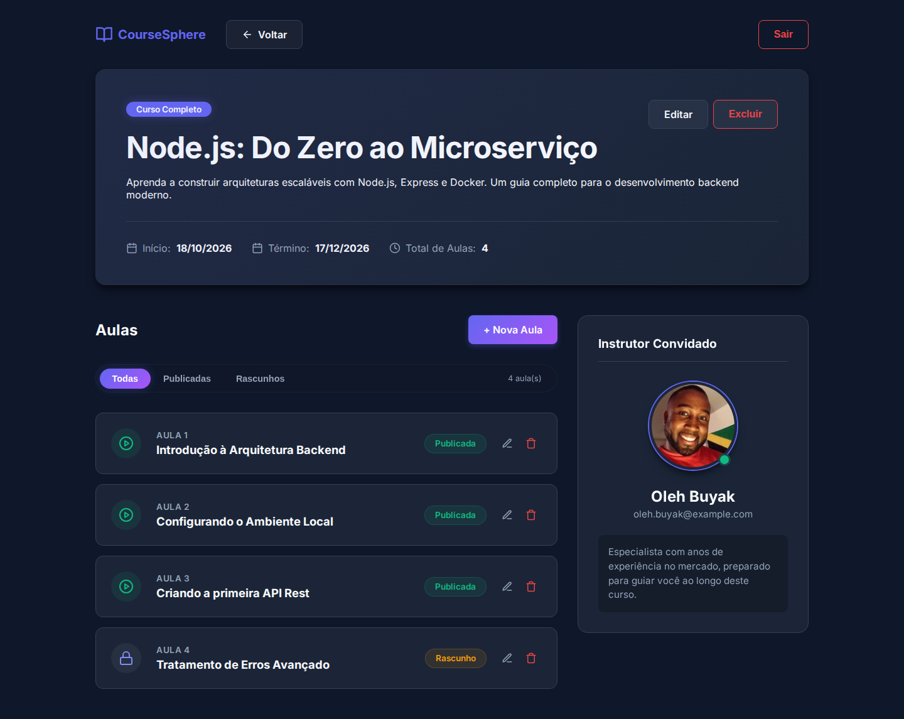
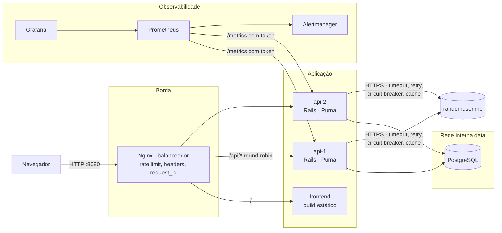
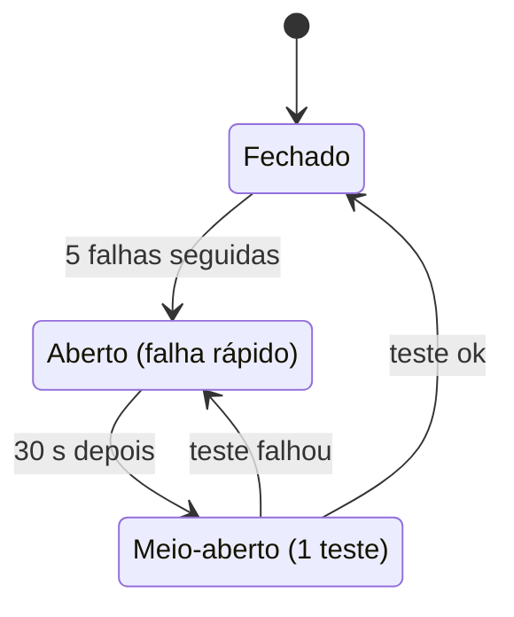
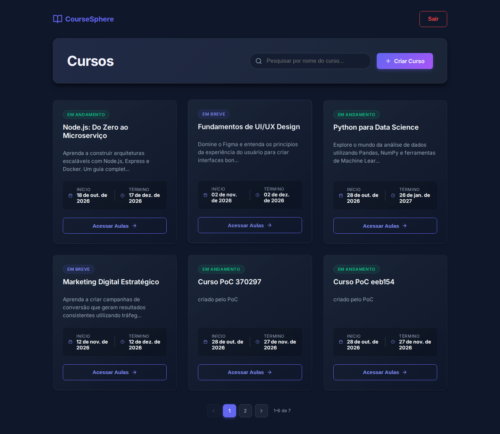

# CourseSphere · AppSec & SRE

**Pentest, correção e operação segura de uma plataforma de cursos: do achado com prova de conceito ao deploy GitOps monitorado por SLOs.**

Ruby on Rails 8.1 · React 19 · PostgreSQL · Nginx · Docker · Kubernetes · Terraform · ArgoCD · Prometheus · Grafana

[](https://github.com/soninhoxs/Desafio_Tecnico_AppSec---DEVOPS/actions/workflows/ci.yml)
[](https://github.com/soninhoxs/Desafio_Tecnico_AppSec---DEVOPS/actions/workflows/security.yml)
[](https://github.com/soninhoxs/Desafio_Tecnico_AppSec---DEVOPS/actions/workflows/e2e.yml)
[](https://github.com/soninhoxs/Desafio_Tecnico_AppSec---DEVOPS/actions/workflows/cd.yml)

Repositório: [soninhoxs/Desafio_Tecnico_AppSec---DEVOPS](https://github.com/soninhoxs/Desafio_Tecnico_AppSec---DEVOPS) · Relatório técnico completo: [`docs/RELATORIO.md`](docs/RELATORIO.md)



_Página do curso na versão corrigida, capturada pelo E2E a cada push na `main`. As aulas em rascunho só aparecem para quem criou o curso. O card "Instrutor Convidado" vem da API, que chama a dependência externa com timeout, retry, circuit breaker e cache._

---

## Sobre o projeto

O **CourseSphere** é uma aplicação de gestão de cursos e aulas (API Rails + SPA React) criada por [PauloV1/CourseSphere-Full-Stack](https://github.com/PauloV1/CourseSphere-Full-Stack), sob licença MIT. Este repositório é a resposta ao **Desafio Técnico AppSec & SRE**: atacar a aplicação, corrigir cada falha na causa, endurecer o ambiente e colocá-la para rodar de forma observável e reproduzível.

O histórico original foi preservado. A versão analisada está na tag **`v0-original`**, e cada mudança deste trabalho vem depois dela, em commits separados por assunto.

### Problema

A versão original funcionava, mas não resistia a um atacante nem a um incidente:

- toda instalação nova criava contas de instrutor com a senha `password123`, publicada no README;
- a aplicação ia ao ar em modo de desenvolvimento, com stack trace nas respostas, `/rails/info` aberto e o servidor de desenvolvimento do Vite;
- nada limitava tentativas de login, senhas como `123456` eram aceitas e o logout não invalidava o token;
- havia 30 vulnerabilidades conhecidas nas gems e 14 no npm;
- rodava em instância única, sem health check, métricas ou logs estruturados, e o navegador chamava um serviço externo sem timeout nem fallback.

### Solução

- **Pentest com prova** — 9 achados classificados com CVSS 3.1, OWASP Top 10:2025 e CWE. Um PoC automatizado mostra cada um como **VULNERÁVEL** na versão original e **CORRIGIDO** na `main`.
- **Correção na causa** — um commit por achado, cada um com teste de regressão e, quando faz sentido, uma regra Semgrep que impede a volta do problema.
- **Defesa em profundidade** — 13 controles de hardening: rate limit em 3 camadas, CSP sem `unsafe-inline`, JWT com revogação, containers non-root e read-only, Pod Security `restricted`, NetworkPolicies default-deny e Kyverno.
- **Operação mensurável** — 2 réplicas atrás do Nginx, logs JSON com `request_id` de ponta a ponta, métricas Prometheus, 3 SLOs com alertas de burn rate, dashboard Grafana provisionado e runbooks.
- **Falha controlada** — a dependência externa passa pela API com timeout, retry com backoff e jitter, circuit breaker, cache e fallback.
- **Entrega segura** — CI/CD com SAST, SCA, DAST, varredura de segredos e de IaC, gate de CVE na imagem, SBOM, assinatura cosign e deploy GitOps (ArgoCD) num cluster criado por Terraform.
- **Evidência versionada** — o E2E publica no repositório o PoC, o balanceamento, o exercício de falha, o OWASP ZAP e os prints de cada execução.

---

## Resultados

| | |
|---|---|
| **Vulnerabilidades** | **9** encontradas (3 Altas, 4 Médias, 2 Baixas no contexto) e **9 corrigidas**, com teste automatizado e PoC |
| **Dependências** | gems **30 → 0** · npm **14 → 0** vulnerabilidades conhecidas · monitoradas pelos alertas do Dependabot |
| **Hardening** | 13 controles além das correções, de headers HTTP a políticas de admissão no Kubernetes |
| **Confiabilidade** | Nginx balanceando **2 réplicas**, health checks, logs JSON, métricas, **3 SLOs**, 11 alertas com runbook e dashboard Grafana |
| **Plataforma** | Terraform cria o cluster kind + ArgoCD · CI/CD com gates de segurança e deploy GitOps |
| **Testes** | 131 testes no backend (autorização, autenticação, força bruta, circuit breaker, observabilidade) + PoC nas duas versões |
| **Evidências** | resultados reais do CI versionados em [`docs/evidencias/execucao/`](docs/evidencias/execucao/), atualizados a cada push na `main` |

| ID | Vulnerabilidade | OWASP Top 10:2025 | CVSS 3.1 | Severidade | Correção |
|---|---|---|---|---|---|
| VULN-04 | Credenciais padrão (`password123`) criadas em qualquer ambiente | A07 Authentication Failures | 8.6 | **Alta** | [`476f0c5`][c-476f0c5] |
| VULN-05 | Aplicação publicada em modo de desenvolvimento | A02 Security Misconfiguration | 5.3 | **Alta** | [`19b1aed`][c-19b1aed] |
| VULN-03 | Sem proteção contra força bruta no login | A07 Authentication Failures | 6.5 | **Alta** | [`fd20df1`][c-fd20df1] |
| VULN-07 | Dependências com CVEs conhecidas (30 gems, 14 npm) | A03 Software Supply Chain Failures | 7.4 | Média | [`dc94e81`][c-dc94e81] |
| VULN-01 | Aulas em rascunho visíveis para qualquer usuário | A01 Broken Access Control | 4.3 | Média | [`06cdccf`][c-06cdccf] |
| VULN-02 | Logout não invalida o JWT | A07 Authentication Failures | 4.8 | Média | [`16ce453`][c-16ce453] |
| VULN-09 | Política de senha fraca (`123456` aceita) | A07 Authentication Failures | 4.8 | Média | [`b3859fd`][c-b3859fd] |
| VULN-06 | `video_url` aceita `javascript:` (XSS armazenado latente) | A05 Injection | 4.4 | Baixa | [`0994800`][c-0994800] |
| VULN-08 | Tempo do login revela e-mails cadastrados | A07 Authentication Failures | 5.3 | Baixa | [`ae89af9`][c-ae89af9] |

A **severidade** considera o contexto real, não só o CVSS base. A VULN-07 tem CVSS alto, mas a parte vulnerável das bibliotecas não era alcançável nesta aplicação. A VULN-05 tem CVSS moderado, mas abria caminho para as outras falhas. Vetor CVSS, CWE, reprodução com `curl`, impacto no negócio e causa raiz de cada achado estão no [relatório](docs/RELATORIO.md#4-achados-detalhados). O controle "um usuário não edita o curso de outro" já funcionava na versão original e foi confirmado por teste.

---

## Arquitetura



O navegador fala só com o balanceador. O Nginx serve o frontend estático e distribui `/api/*` entre as duas réplicas da API, com rate limit na borda e um `request_id` que aparece no log do balanceador **e** no da API, o que permite seguir uma requisição de ponta a ponta. As réplicas alcançam o PostgreSQL só pela rede interna `data`, com um usuário de banco sem superusuário. `/health/live` diz se o processo está vivo, sem tocar no banco; `/health/ready` testa o PostgreSQL, e a réplica sem banco sai do balanceamento. O Prometheus coleta `/metrics` com token, e o balanceador responde 404 para `/api/metrics`: as métricas não ficam expostas na borda.

No Kubernetes, a mesma topologia usa Traefik (ingress), Deployment com 2 a 5 réplicas (HPA), PDB, StatefulSet do PostgreSQL, kube-prometheus-stack e Loki/Alloy para logs, tudo sincronizado pelo ArgoCD a partir deste repositório.

### Superfície da API

Pelo balanceador, todas as rotas ficam sob `http://localhost:8080/api`.

| Método | Endpoint | Acesso | Controle |
|---|---|---|---|
| `POST` | `/signup` | público | senha com 12+ caracteres, sem senhas comuns · 10 cadastros por IP a cada 10 min, além do limite na borda |
| `POST` | `/login` | público | 10 tentativas/min por IP, na borda e na API · conta bloqueada por 15 min após 5 falhas seguidas · mesma resposta e mesmo tempo para e-mail existente ou não |
| `DELETE` | `/logout` | JWT | revoga o `jti` do token usado: ele deixa de autenticar antes de expirar |
| `GET` | `/me` | JWT | dados do próprio usuário |
| `GET` `POST` | `/courses` | JWT | listagem e criação de cursos |
| `GET` `PATCH` `DELETE` | `/courses/:id` | JWT | editar e excluir só o criador (403 + evento `access_denied`) |
| `GET` `POST` | `/courses/:course_id/lessons` | JWT | rascunhos só aparecem para o criador do curso · criar aula só o criador |
| `GET` `PATCH` `DELETE` | `/lessons/:id` | JWT | rascunho de outro criador responde 404, sem confirmar que existe · editar e excluir só o criador · `video_url` só `http`/`https` |
| `GET` | `/courses/:course_id/guest_instructor` | JWT | dependência externa protegida · sempre 200, com fallback `available: false` |
| `GET` | `/health`, `/health/live`, `/health/ready` | público | processo vivo × banco acessível |
| `GET` | `/metrics` | token `METRICS_TOKEN` | comparação em tempo constante · bloqueado na borda (404) |

Toda resposta da API leva CSP `default-src 'none'; frame-ancestors 'none'` e `Cross-Origin-Resource-Policy: same-origin`. As rotas da aplicação também levam `Cache-Control: no-store`, para que dados de usuário não fiquem em cache.

---

## Decisões de engenharia

**Autorização na consulta, não na tela.** `Lesson.visible_to(current_user)` aplica a regra de rascunho na própria busca do banco, tanto na listagem quanto no `GET /lessons/:id`. Um rascunho de outro criador responde **404**, e não 403, para não confirmar que a aula existe. Criar, editar e excluir passam por `authorize_creator!`, que responde 403 e registra o evento de segurança `access_denied`.

**Login que não vaza informação.** `User.authenticate_by` gasta o mesmo tempo de bcrypt com ou sem conta cadastrada, e a resposta é igual para senha errada, e-mail inexistente e conta bloqueada. O e-mail nunca vai para o log em claro: os eventos levam um hash curto (`email_fp`) que permite correlacionar tentativas contra a mesma conta.

**Força bruta barrada em três camadas.** Borda (Nginx, por IP), aplicação (`rate_limit` do Rails, com store compartilhado entre as réplicas) e conta (bloqueio após 5 falhas seguidas). O limite por IP sozinho não segura um ataque distribuído. O bloqueio de conta sozinho viraria negação de serviço contra o próprio usuário, por isso ele dura só 15 minutos.

**JWT com revogação.** Algoritmo fixo, claims obrigatórias, `jti` e chave derivada. O logout grava o `jti` em `RevokedToken`, e toda requisição consulta essa lista antes de aceitar o token. Tokens com `alg: none`, assinados com outra chave, expirados ou sem `jti` são recusados (há teste para cada caso).

**Segredos fora do Git.** `scripts/bootstrap_env.py` gera o `.env` com valores aleatórios. No Kubernetes, quem cria os segredos é o Terraform. Não existe mais senha padrão: os usuários de demonstração usam a senha gerada no `.env`. O Gitleaks varre o histórico completo a cada push.

**Produção de verdade.** A API roda em modo de produção carregando só ActiveRecord e ActionController (5 gems e frameworks não usados foram removidos). O frontend é um build estático servido por Nginx com CSP sem `unsafe-inline` nem `unsafe-eval`. Erros voltam como JSON, sem stack trace.

**Containers com o mínimo.** Usuário não-root (uid 10001), rootfs somente leitura com `tmpfs` só onde precisa, `cap_drop: ALL`, `no-new-privileges`, limites de CPU, memória e pids, portas publicadas só em `127.0.0.1` e banco numa rede interna. No Kubernetes, Pod Security `restricted`, NetworkPolicies default-deny e Kyverno exigindo limites, probes, rootfs read-only e imagens de registries permitidos.

**Falhar rápido quando o terceiro cai.** O card do instrutor convidado chamava a `randomuser.me` direto do navegador. Agora a chamada passa pela API (`GuestInstructorClient` + `CircuitBreaker`):

| Proteção | Valor | Por quê |
|---|---|---|
| Timeout | conexão 0,5 s, leitura 1,5 s, **teto rígido de 2 s** por tentativa | o timeout de leitura vale para cada leitura do socket; sem o teto, uma resposta lenta segura a thread |
| Retry | até 3 tentativas, **backoff exponencial com jitter**, só para timeout, erro de rede e HTTP 429/5xx | erro permanente não melhora repetindo; o jitter evita que as réplicas repitam juntas |
| Orçamento | 3 s por requisição, somando tentativas e esperas | o retry nunca passa do tempo que o usuário aceitaria esperar |
| Circuit breaker | abre com **5 falhas seguidas**, fica aberto 30 s e deixa passar **1 chamada de teste** | com a dependência fora do ar, a API para de gastar threads em timeout e responde na hora |
| Cache | 24 h por curso, compartilhado entre réplicas | menos chamadas externas; o que já foi consultado continua disponível durante a falha |
| Fallback | `200 {"available": false, "instructor": null}` | a página do curso continua funcionando, só sem o card |



A URL externa é fixa (só o id numérico do curso entra na consulta, sem SSRF), a resposta é reduzida a nome, e-mail e foto, e a NetworkPolicy libera para a internet só HTTPS, bloqueando redes privadas e o endereço de metadados da nuvem. O endpoint fica fora do SLO do CRUD: uma falha de terceiro já tratada com fallback não consome o orçamento de erro da função principal.

**Cadeia de suprimentos verificável.** Actions fixadas por SHA de commit, ferramentas baixadas com SHA-256 conferido, Dependabot com espera de 7 dias para versões recém-publicadas, alertas do Dependabot ligados, gate do Trivy na imagem, SBOM CycloneDX e assinatura cosign antes do deploy.

| # | Hardening | Onde |
|---|---|---|
| H1 | Rate limit em 3 camadas (borda + IP + conta), com store compartilhado entre réplicas | Nginx, Traefik, `RateLimiting`, `User` |
| H2 | Cabeçalhos: CSP sem `unsafe-*`, HSTS, `X-Frame-Options: DENY`, `nosniff`, `Referrer-Policy`, `Permissions-Policy`, COOP; API com `default-src 'none'`, CORP e `no-store` | `frontend/nginx/security-headers.conf`, `config/application.rb` |
| H3 | Validação no backend: allowlist de URL, limites de tamanho, normalização de e-mail e título | modelos |
| H4 | JWT endurecido: algoritmo fixo, claims obrigatórias, `jti` + revogação, chave derivada, TTL configurável | `JsonWebToken`, `RevokedToken` |
| H5 | Senhas: bcrypt + política NIST (12+ caracteres) + bloqueio de senhas comuns | `User` |
| H6 | Superfície reduzida: só ActiveRecord + ActionController; 5 gems removidas | `config/application.rb`, `Gemfile` |
| H7 | Containers non-root, read-only, sem capabilities, com limites e redes segmentadas | `docker-compose.yml`, Dockerfiles |
| H8 | Banco com menor privilégio: a API não usa superusuário | `deploy/compose/postgres/initdb` |
| H9 | Kubernetes: Pod Security `restricted`, NetworkPolicies default-deny, Kyverno, sem token de service account | `deploy/k8s`, `deploy/policies` |
| H10 | Cadeia de suprimentos: Actions por SHA, ferramentas com SHA-256, Dependabot, SBOM, cosign, gate de CVE | `.github/` |
| H11 | Detecção: eventos de segurança em log JSON, métricas e alertas (força bruta, contas bloqueadas, pico de 403) | `lib/observability`, regras Prometheus |
| H12 | Dependência externa isolada: URL fixa, resposta limitada, CSP `connect-src 'self'`, egress só HTTPS | `guest_instructor_client.rb`, `deploy/k8s/base/network-policies.yaml` |
| H13 | Processo: [`SECURITY.md`](SECURITY.md) com prazos por severidade e relato privado de vulnerabilidades ativado no GitHub | `SECURITY.md`, Settings → Advanced Security |

---

## Observabilidade e confiabilidade

| Sinal | Onde nasce | Como acessar |
|---|---|---|
| **Logs JSON da API** — uma linha por requisição, eventos de segurança e erros | `lib/observability/` | `docker compose logs api-1 api-2` · Loki no Kubernetes |
| **Logs JSON do balanceador** — com a réplica que atendeu (`upstream`) | `deploy/compose/nginx/nginx.conf` | `docker compose logs lb` |
| **Métricas Prometheus** — requisições, latência, eventos de segurança, pool do banco, dependência externa | `GET /metrics` em cada réplica | Prometheus `:9090`, Grafana `:3001` |
| **Health checks** | `/health/live`, `/health/ready` | balanceador, Docker, probes do Kubernetes |

```json
{"ts":"2026-10-26T18:52:44.939Z","level":"INFO","service":"coursesphere-api","instance":"api-2",
 "event":"http_request","method":"GET","path":"/courses/12","route":"/courses/:id","status":200,
 "duration_ms":8.41,"request_id":"6c1f0d2e9b8a4c1f","user_id":7,"remote_ip":"172.20.0.1"}
```

| SLO | SLI | Meta (30 dias) |
|---|---|---|
| **SLO-1 — Disponibilidade do CRUD** | requisições a `/courses*` e `/lessons*` sem 5xx | **99,5%** (≈ 3h36min de orçamento por mês) |
| **SLO-2 — Latência do login** | `POST /login` em menos de 500 ms | **99%** |
| **SLO-3 — Latência de leitura** | `GET` de cursos e aulas em menos de 250 ms | **99%** |

Os alertas de SLO usam **burn rate multi-janela** (Google SRE Workbook): disparam quando o orçamento de erro está sendo consumido rápido demais na janela longa **e** na curta, e não a cada erro isolado. São 11 alertas no total, todos com runbook em [`docs/runbooks/`](docs/runbooks/): burn rate do CRUD (rápido e lento), latência do login, réplica fora do ar, todas as réplicas fora, pool do banco saturado, força bruta, contas sendo bloqueadas, pico de 403, disjuntor aberto e dependência falhando. Consultas PromQL e detalhes: [`docs/observabilidade.md`](docs/observabilidade.md).


_Dashboard "CourseSphere — SLOs, tráfego e segurança", provisionado automaticamente e capturado pelo E2E: SLOs e orçamento de erro, requisições por réplica (prova visual do balanceamento), erros e latência, eventos de segurança e o estado do circuit breaker de cada réplica._

### Demonstrar o balanceamento entre as 2 réplicas

```bash
python scripts/lb_demo.py -n 20
```

```
  #01 status=200 x-served-by=api-1    body.instance=api-1
  #02 status=200 x-served-by=api-2    body.instance=api-2
  ...
Distribuição:
  api-1     10 req  ##########
  api-2     10 req  ##########
```

A mesma evidência aparece no log JSON do balanceador (`docker compose logs lb`, campo `upstream`) e no painel **"Requisições/s por réplica"** do Grafana.

### Demonstrar o tratamento de falhas (circuit breaker)

```bash
docker compose exec -T api-1 bin/rails runner script/resilience_drill.rb
```

O exercício chama a `randomuser.me` de verdade (a segunda chamada vem do cache). Depois simula a dependência **fora do ar** com um IP que não responde: cada requisição fica limitada ao orçamento de tempo até o disjuntor abrir, e daí em diante a resposta é **imediata**, com fallback. O exercício roda num processo à parte, com disjuntor próprio, e não interfere nas réplicas que atendem o tráfego. A saída da última execução no CI está em [`docs/evidencias/execucao/`](docs/evidencias/execucao/).

---

## Pipeline e segurança na entrega

| Workflow | Quando | O que faz |
|---|---|---|
| `ci.yml` | push/PR | testes Rails + PostgreSQL, RuboCop, ESLint + build, validação de Terraform/K8s/ArgoCD/Prometheus/compose |
| `security.yml` | push/PR + semanal | Semgrep, Brakeman, bundler-audit, npm audit, Trivy (fs/config), Gitleaks |
| `cd.yml` | push na `main` | banco do Trivy no GHCR (cache por digest) → build → **Trivy na imagem (gate)** → SBOM → push GHCR → **assinatura cosign** → commit da nova tag no overlay → **ArgoCD faz o deploy** |
| `e2e.yml` | push/PR | compose da versão corrigida (balanceamento + PoC + exercício de falha + ZAP + prints) e da `v0-original` (o PoC deve mostrar as falhas); na `main`, publica tudo em `docs/evidencias/execucao/` |
| `k8s-e2e.yml` | manual + semanal | Terraform cria o kind, o ArgoCD sincroniza deste repositório, smoke test + PoC via ingress |

Todas as actions são fixadas por **SHA de commit** e as ferramentas são baixadas com **SHA-256 verificado**.

| Ferramenta | Para quê | Como rodar localmente | No CI |
|---|---|---|---|
| **Brakeman** | SAST Rails | `cd backend && bundle install && bin/brakeman` | `security.yml` |
| **Semgrep** | SAST (regras próprias + OWASP) | `pip install semgrep && semgrep scan --config security/semgrep/coursesphere.yml --config p/owasp-top-ten` | `security.yml` (regras próprias bloqueiam) |
| **bundler-audit** | CVEs em gems | `cd backend && bin/bundler-audit check --update` | `security.yml` |
| **npm audit** | CVEs no frontend | `cd frontend && npm audit` | `security.yml` |
| **Trivy** | CVEs, segredos, IaC, imagens | `trivy fs .` · `trivy config --ignorefile .trivyignore.yaml .` · `trivy image coursesphere-api:local` | `security.yml`, `cd.yml` (gate) |
| **Gitleaks** | Segredos no histórico Git | `gitleaks git --config .gitleaks.toml .` | `security.yml` |
| **Dependabot** | Alertas de CVE nas dependências (gems, npm, Actions) e PRs semanais de atualização, com espera de 7 dias | — (`.github/dependabot.yml` + Settings → Advanced Security) | GitHub, contínuo |
| **OWASP ZAP** | DAST (baseline passivo) | `docker run --rm --network host ghcr.io/zaproxy/zaproxy:stable zap-baseline.py -t http://localhost:8080` | `e2e.yml` |
| **PoC próprio** | Prova de cada achado | `python security/poc/poc.py --base-url ...` | `e2e.yml`, `k8s-e2e.yml` |
| **kubeconform / helm / kustomize** | Validação dos manifests e charts do ArgoCD | `python scripts/validate_gitops.py` | `ci.yml` |
| **promtool** | Regras e alertas do Prometheus | `promtool check rules deploy/observability/prometheus/rules/*.yml` | `ci.yml` |
| **Terraform** | Validação da IaC | `cd deploy/terraform/kind && terraform init -backend=false && terraform validate` | `ci.yml` |
| **Minitest** | Testes (incl. autorização e circuit breaker) | `cd backend && bin/rails test` (precisa de PostgreSQL) | `ci.yml` |
| **Exercício de falha** | Circuit breaker com a dependência fora do ar | `docker compose exec -T api-1 bin/rails runner script/resilience_drill.rb` | `e2e.yml` |
| **Playwright** | Prints da aplicação e do Grafana | `pip install playwright==1.64.0 && python -m playwright install chromium && python scripts/ci/capture_screenshots.py --out out` | `e2e.yml` |

### O que os gates já barraram

Desde a primeira execução no GitHub, o próprio pipeline pegou (e foi corrigido):

- **Gate do Trivy na imagem:** reprovou o deploy por **CVE-2026-33210 (CRITICAL)** na gem `json` 2.18.0 que vem *dentro* do Ruby 4.0.9. O lockfile já usava a versão corrigida, mas a gem padrão continuava na imagem. Também pegou pacotes do sistema operacional com correção publicada depois da tag da imagem base (resolvido com `apt-get upgrade`/`apk upgrade` no build).
- **E2E:** três falhas que só aparecem em produção: um initializer chamava um logger que a API não carrega (`NameError` no boot), o `tmpfs` nascia `root:755` e o processo (uid 10001) não criava `tmp/pids`, e o healthcheck usava `wget` numa imagem que só tem `curl`.
- **CI:** divergência entre as migrations e o `db/schema.rb`, e a falta da biblioteca `active_job` no eager load do Solid Cache.
- **Trivy config:** levou a namespace explícito nos workloads, frontend com uid > 10000 e `Host` fixo no proxy (o cliente não escolhe mais o cabeçalho que a API recebe).
- **Print do Grafana:** mostrou o SLO-1 e o orçamento de erro como "No data", porque sem nenhum 5xx a série de erro não existe. O painel do disjuntor também ficava vazio até a primeira troca de estado. Correção: numeradores de erro com `or vector(0)` e séries da dependência iniciadas em zero no boot.

---

## Evidências da execução real

[`docs/evidencias/execucao/`](docs/evidencias/execucao/) é gerada pelo CI a cada push na `main` que passa no E2E. Antes, isso existia só como artefato do Actions, que exige login e expira em 90 dias. Tokens JWT são removidos antes do commit.

| Arquivo | O que prova |
|---|---|
| `poc-versao-original.txt` · `poc-versao-corrigida.txt` | cada achado **VULNERÁVEL** na `v0-original` e **CORRIGIDO** na `main`, com a requisição e a resposta |
| `balanceamento-lb-demo.txt` · `balanceamento-log-nginx.txt` · `prometheus-requests-por-instancia.json` | requisições atendidas por `api-1` e `api-2`: header `X-Served-By`, log do Nginx e contagem no Prometheus |
| `resiliencia-circuit-breaker.txt` · `prometheus-dependencia-externa.json` | exercício de falha: chamada real, cache, dependência fora do ar e disjuntor abrindo |
| `headers-api.txt` · `headers-frontend.txt` | cabeçalhos de segurança em produção |
| `metrics-bloqueado-na-borda.txt` | `/api/metrics` não fica exposto no balanceador |
| `logs-api-json.txt` · `prometheus-eventos-seguranca.json` | logs estruturados e eventos de segurança gerados durante o PoC |
| `zap-baseline.md` | varredura DAST passiva (OWASP ZAP) |
| `app-cursos.png` · `app-curso-instrutor.png` · `grafana-dashboard.png` | prints da aplicação e do dashboard |

O [`README`](docs/evidencias/execucao/README.md) da pasta resume a execução. Resultados das ferramentas de SAST/SCA antes e depois das correções: [`docs/evidencias/baseline/`](docs/evidencias/baseline/) e [`docs/evidencias/depois/`](docs/evidencias/depois/).



_Lista de cursos depois do login com o usuário de demonstração, na versão corrigida. Os cursos "Curso PoC" são criados pelo próprio PoC durante o E2E._

---

## Como executar

**Pré-requisitos:** Docker com Compose v2 (Docker Desktop no Windows/macOS) e Python 3.9+ (só para os scripts auxiliares, sem dependências).

```bash
git clone https://github.com/soninhoxs/Desafio_Tecnico_AppSec---DEVOPS.git
cd Desafio_Tecnico_AppSec---DEVOPS
python scripts/bootstrap_env.py      # gera .env com segredos aleatórios (não vai para o Git)
docker compose up -d --build
python scripts/wait_for_http.py http://localhost:8080/api/health
```

| Serviço | URL |
|---|---|
| Aplicação | http://localhost:8080 |
| API (via balanceador) | http://localhost:8080/api/health |
| Grafana (dashboard já provisionado) | http://localhost:3001 — usuário `admin`, senha impressa pelo `bootstrap_env.py` |
| Prometheus | http://localhost:9090 |
| Alertmanager | http://localhost:9093 |

Usuários de demonstração: `tech@coursesphere.com` e `design@coursesphere.com`, com a senha `DEMO_USER_PASSWORD` do `.env`. Também dá para criar uma conta nova pela tela de cadastro.

Para parar: `docker compose down` (com `-v`, apaga também os dados).

### Rodar sem Docker (desenvolvimento)

```bash
# API (Ruby 4.0.9 + PostgreSQL local)
cd backend && bundle install && bin/rails db:prepare && bin/rails server
# Frontend (o Vite encaminha /api para :3000)
cd frontend && npm ci && npm run dev
```

---

## Reproduzir os achados

O script `security/poc/poc.py` (só biblioteca padrão do Python) testa cada vulnerabilidade, cria os próprios usuários e mostra **VULNERÁVEL** ou **CORRIGIDO** com a requisição e a resposta que comprovam.

**1. Versão original (vulnerável)**, numa cópia separada, sem mexer na `main`:

```bash
git worktree add ../coursesphere-original v0-original
cd ../coursesphere-original && docker compose up -d --build   # compose ORIGINAL (API em :3000)
cd -                                                           # volta para a main
python scripts/wait_for_http.py http://localhost:3000/courses --status 401 --timeout 600
python security/poc/poc.py --base-url http://localhost:3000
(cd ../coursesphere-original && docker compose down -v) && git worktree remove ../coursesphere-original
```

**2. Versão corrigida**

```bash
docker compose up -d --build
python security/poc/poc.py --base-url http://localhost:8080/api
```

Saída esperada na versão corrigida (resumo):

```
[CORRIGIDO   ] VULN-01   Aula em rascunho visível para outro usuário
[PROTEGIDO   ] CONTROLE  Editar/excluir curso de outro criador (IDOR)
[CORRIGIDO   ] VULN-02   JWT continua válido após logout
...
```

Passos manuais com `curl` para cada achado estão no [relatório](docs/RELATORIO.md#4-achados-detalhados). No GitHub Actions, o workflow **E2E** roda o PoC nas duas versões a cada push.

---

## Kubernetes com Terraform + GitOps (ArgoCD)

**Pré-requisitos:** Docker, Terraform ≥ 1.9 e kubectl. O ArgoCD lê os manifests do GitHub, então o cluster precisa alcançar o repositório.

```bash
cd deploy/terraform/kind
terraform init
terraform apply -var repo_url=https://github.com/soninhoxs/Desafio_Tecnico_AppSec---DEVOPS.git
export KUBECONFIG=$(terraform output -raw kubeconfig_path)
kubectl -n argocd get applications          # plataforma + app sincronizando
```

O Terraform cria o cluster **kind** (1 control-plane + 2 workers), os namespaces (Pod Security `restricted`), os **segredos aleatórios** (nunca no Git) e instala o ArgoCD com uma única Application `root`. A partir daí, **o Git é a fonte da verdade**: o ArgoCD aplica Traefik, metrics-server, Kyverno (+ políticas), kube-prometheus-stack, Loki, Alloy e a aplicação.

| URL (kind) | |
|---|---|
| http://coursesphere.localhost:8080 | aplicação |
| http://grafana.localhost:8080 | Grafana (`terraform output -raw grafana_admin_password`) |
| http://argocd.localhost:8080 | ArgoCD (`admin` + `terraform output argocd_admin_password_command`) |

**Imagens:** por padrão, o overlay `kind` usa as imagens que o pipeline de CD publica no GHCR (o pacote precisa estar **público** ou com `imagePullSecret`). Para testar sem registry: `bash scripts/kind_load_images.sh` + `-var app_overlay=kind-local`.

Destruir: `terraform destroy -var repo_url=...`.

---

## Testes

```bash
cd backend && bin/rails test            # 131 testes; precisa de PostgreSQL
cd frontend && npm run lint && npm run build
python security/poc/poc.py --base-url http://localhost:8080/api
```

| Área | Arquivos | O que cobre |
|---|---|---|
| **Autorização** | `courses_controller_test.rb`, `lessons_controller_test.rb` | não-criador não edita nem exclui curso ou aula (403), não vê rascunhos (404), 401 sem token, `video_url` com `javascript:` recusada |
| **Autenticação** | `authentication_controller_test.rb` | token deixa de valer após o logout, `jti` revogado, `alg: none`, outra chave, token expirado, mesma resposta para e-mail inexistente e senha errada |
| **Força bruta** | `brute_force_protection_test.rb` | bloqueio após 5 falhas, bloqueio temporário, contador zerado no sucesso, 429 por IP no login e no cadastro |
| **Modelos** | `user_test.rb`, `lesson_test.rb`, `course_test.rb` | política de senha, URLs perigosas, limites de tamanho, datas |
| **Resiliência** | `circuit_breaker_test.rb`, `guest_instructor_client_test.rb`, `guest_instructors_controller_test.rb` | estados do disjuntor, retry só em erro transitório, cache, URL fixa, fallback 200 |
| **Observabilidade** | `observability_test.rb` | liveness × readiness, `/metrics` com token, séries iniciadas no boot, eventos de segurança, headers de segurança e `no-store` |

Passo a passo para rodar a mesma verificação do CI na máquina (schema, lint, PoC, balanceador e o que cada falha significa): [`docs/VERIFICACAO.md`](docs/VERIFICACAO.md).

---

## Revisão contra o edital

Revisão feita item a item contra o edital do desafio. O que faltava ou estava fraco:

| Melhoria | Item do edital atendido | Onde |
|---|---|---|
| **Evidências reais publicadas no repositório.** A cada push na `main` que passa no E2E, o CI grava o PoC da versão original × corrigida, a distribuição do balanceador por réplica, o log JSON do Nginx, métricas do Prometheus, o exercício de falha, o resumo do OWASP ZAP e **prints** da aplicação e do dashboard. | 5 ("print ou log mostrando requests atendidas por instâncias diferentes"), 6 (evidências: prints, logs, requests/responses), reprodutibilidade | [`docs/evidencias/execucao/`](docs/evidencias/execucao/), `.github/workflows/e2e.yml` (job `publish`), `scripts/ci/` |
| **Tratamento de falhas na dependência externa.** Timeout com teto de 2 s, retry com backoff + jitter, **circuit breaker**, cache de 24 h e fallback. | Diferencial: "tratamento de falhas (timeout, retry, circuit breaker)" | `backend/app/services/`, `GET /api/courses/:id/guest_instructor`, [runbook](docs/runbooks/dependencia-externa.md) |
| **Observabilidade da dependência:** métricas de chamadas, latência e estado do disjuntor, linha nova no dashboard, alertas `ExternalDependencyCircuitOpen`/`ExternalDependencyFailing` e exercício de falha no E2E. | 4 (métricas, dashboard) | `backend/lib/observability/metrics.rb`, `deploy/observability/` |
| **Segurança da mudança:** URL fixa (sem SSRF), resposta reduzida a nome/e-mail/foto, CSP `connect-src 'self'` (o JavaScript do navegador não chama mais terceiros; só a foto ainda vem da `randomuser.me`) e NetworkPolicy que libera só HTTPS para a internet. | 3 (hardening) | `guest_instructor_client.rb`, `frontend/nginx/security-headers.conf`, `deploy/k8s/base/network-policies.yaml` |
| **Política de segurança e recursos de segurança do GitHub.** A aba de segurança indicava "No security policy detected". Agora o `SECURITY.md` define o canal de reporte, prazos por severidade e regras para testes. No repositório foram ligados o **relato privado de vulnerabilidades** (botão **Report a vulnerability** em Security and quality → Advisories), o **grafo de dependências** e os **alertas do Dependabot**. Na ativação, as 284 versões de gems e npm do grafo foram cruzadas com o GitHub Advisory Database: nenhum aviso conhecido. | Postura de segurança, 7 (SCA) | [`SECURITY.md`](SECURITY.md), Settings → Advanced Security |
| **Alerta do Code scanning (Semgrep) tratado.** A regra de regex de URI passou a valer só para `backend/`: o script de evidência da VULN-06 usa a regex antiga de propósito, para comparar com a validação nova. | 7 (SAST no repositório) | `security/semgrep/coursesphere.yml` |
| **19 testes novos** (circuit breaker, cliente da dependência com transporte falso, endpoint). | Diferencial: testes automatizados | `backend/test/services/`, `backend/test/controllers/guest_instructors_controller_test.rb` |

---

## Os 4 pilares

| Pilar | Onde |
|---|---|
| **Infraestrutura** — ambientes, cluster, rede, armazenamento | `docker-compose.yml`, `deploy/terraform/kind`, `deploy/k8s` (NetworkPolicies, PVC, HPA, PDB) |
| **Automações** — build, teste, deploy, CI/CD | `.github/workflows`, `scripts/`, `deploy/argocd` (GitOps) |
| **Observabilidade** — monitoramento, logs, alertas, incidentes | `backend/lib/observability`, `deploy/observability`, `docs/observabilidade.md`, `docs/runbooks`, circuit breaker da dependência externa |
| **Segurança** — scan de imagens, políticas, segredos | correções (`backend/`), `security/`, `deploy/policies` (Kyverno), Trivy/cosign no CD, alertas do Dependabot, segredos via Terraform/.env, `SECURITY.md` + relato privado de vulnerabilidades |

---

## Estrutura do repositório

```
├── .github/
│   ├── workflows/            # CI, segurança, CD, E2E e E2E no Kubernetes
│   └── dependabot.yml        # atualizações semanais com espera de 7 dias
├── backend/                  # API Rails
│   ├── app/
│   │   ├── controllers/      # autorização por criador, login, logout, health, metrics
│   │   ├── models/           # regras de senha, URL e visibilidade de rascunho
│   │   └── services/         # GuestInstructorClient + CircuitBreaker
│   ├── lib/observability/    # logs JSON, eventos de segurança, métricas
│   ├── script/               # exercício de falha (resilience_drill.rb)
│   └── test/                 # 131 testes (controllers, models, services)
├── frontend/                 # React + Nginx com CSP e headers
├── deploy/
│   ├── compose/              # Nginx (balanceador) e init do PostgreSQL
│   ├── k8s/                  # Kustomize: base + overlays (kind, kind-local)
│   ├── argocd/root/          # app-of-apps (Helm)
│   ├── policies/             # Kyverno
│   ├── observability/        # Prometheus (regras e SLOs), Alertmanager, Grafana
│   └── terraform/kind/       # cluster kind + ArgoCD + segredos
├── security/
│   ├── poc/poc.py            # provas de conceito
│   └── semgrep/              # regras próprias
├── docs/
│   ├── RELATORIO.md          # pentest + confiabilidade
│   ├── VERIFICACAO.md        # como provar que a entrega funciona
│   ├── threat-model.md       # STRIDE + DFD
│   ├── observabilidade.md    # sinais, SLOs, alertas, dashboard
│   ├── runbooks/             # um por alerta + modelo de postmortem
│   └── evidencias/           # baseline/ e depois/ (SAST/SCA) · execucao/ (gerada pelo CI)
├── scripts/                  # bootstrap do .env, demo do LB, validação, CI (evidências e prints)
├── docker-compose.yml
└── SECURITY.md               # política de segurança e como reportar vulnerabilidades
```

---

## Documentação

| Documento | Conteúdo |
|---|---|
| [`docs/RELATORIO.md`](docs/RELATORIO.md) | relatório técnico: escopo, metodologia, achados com CVSS e reprodução, hardening, SRE, limitações |
| [`docs/threat-model.md`](docs/threat-model.md) | modelagem de ameaças STRIDE com diagrama de fluxo de dados |
| [`docs/observabilidade.md`](docs/observabilidade.md) | métricas, logs, SLIs/SLOs, PromQL, alertas e dashboard |
| [`docs/runbooks/`](docs/runbooks/) | diagnóstico e mitigação de cada alerta, e modelo de postmortem |
| [`docs/VERIFICACAO.md`](docs/VERIFICACAO.md) | como rodar a mesma verificação do CI na máquina |
| [`SECURITY.md`](SECURITY.md) | versões suportadas, como reportar, prazos e regras para testes |

---

## Créditos e contato

Aplicação original: [PauloV1/CourseSphere-Full-Stack](https://github.com/PauloV1/CourseSphere-Full-Stack) (licença MIT). Análise de segurança, correções, infraestrutura e operação: este repositório, para o **Desafio Técnico AppSec & SRE**.

GitHub: [@soninhoxs](https://github.com/soninhoxs)

[c-476f0c5]: https://github.com/soninhoxs/Desafio_Tecnico_AppSec---DEVOPS/commit/476f0c5
[c-19b1aed]: https://github.com/soninhoxs/Desafio_Tecnico_AppSec---DEVOPS/commit/19b1aed
[c-fd20df1]: https://github.com/soninhoxs/Desafio_Tecnico_AppSec---DEVOPS/commit/fd20df1
[c-dc94e81]: https://github.com/soninhoxs/Desafio_Tecnico_AppSec---DEVOPS/commit/dc94e81
[c-06cdccf]: https://github.com/soninhoxs/Desafio_Tecnico_AppSec---DEVOPS/commit/06cdccf
[c-16ce453]: https://github.com/soninhoxs/Desafio_Tecnico_AppSec---DEVOPS/commit/16ce453
[c-b3859fd]: https://github.com/soninhoxs/Desafio_Tecnico_AppSec---DEVOPS/commit/b3859fd
[c-0994800]: https://github.com/soninhoxs/Desafio_Tecnico_AppSec---DEVOPS/commit/0994800
[c-ae89af9]: https://github.com/soninhoxs/Desafio_Tecnico_AppSec---DEVOPS/commit/ae89af9
