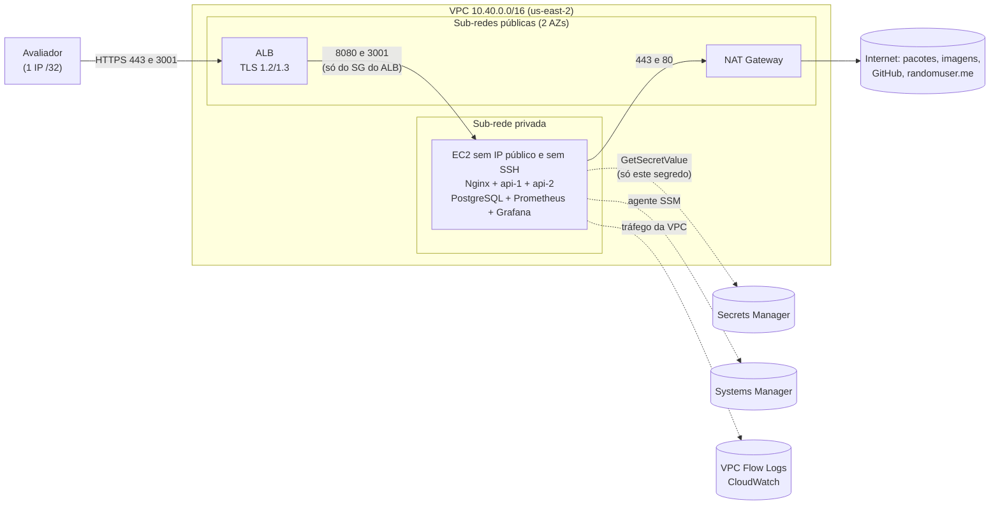

# Deploy na AWS (Terraform)

Ambiente real na AWS com as boas práticas pedidas no edital: **rede privada, IAM com privilégio mínimo e gestão de segredos**. A instância roda o mesmo `docker-compose.yml` do laboratório (Nginx + 2 réplicas da API + PostgreSQL + Prometheus + Grafana), sem IP público, atrás de um ALB que só aceita HTTPS.

Evidências da execução real: [`docs/evidencias/aws/`](../../../docs/evidencias/aws/).

## Arquitetura



| Requisito | Como foi feito | Arquivo |
|---|---|---|
| **Rede privada** | instância na sub-rede privada, sem IP público e sem chave SSH. A saída para a internet passa pelo NAT; nenhuma sub-rede atribui IP público | `network.tf`, `compute.tf` |
| **Entrada restrita** | ALB só com HTTPS (política `ELBSecurityPolicy-TLS13-1-2-2021-06`), liberado só para `allowed_cidr` (0.0.0.0/0 é recusado na validação). Não existe listener na porta 80. Cabeçalhos HTTP inválidos são descartados. A instância só aceita tráfego vindo do security group do ALB | `alb.tf`, `security.tf` |
| **IAM com privilégio mínimo** | o papel da instância tem só o acesso do SSM (administração sem SSH) e `secretsmanager:GetSecretValue` em **um** ARN. Conferido com `iam simulate-principal-policy` | `iam_secrets.tf` |
| **Gestão de segredos** | as senhas e chaves são geradas como valores efêmeros e gravadas por um atributo *write-only*: chegam ao Secrets Manager, mas **não ficam no state do Terraform**. No boot, a instância lê o segredo e monta o `.env` com permissão 600 | `iam_secrets.tf`, `user_data.sh.tftpl` |
| **Metadados da instância** | IMDSv2 obrigatório e *hop limit* 1: os containers não alcançam as credenciais do papel da instância | `compute.tf` |
| **Dados em repouso** | disco gp3 criptografado | `compute.tf` |
| **Auditoria de rede** | VPC Flow Logs de todo o tráfego no CloudWatch (retenção de 7 dias), com papel próprio restrito ao grupo de logs | `network.tf` |
| **Versão publicada** | commit fixado em `git_ref` e conferido no boot. A tag `v0-original` (versão vulnerável) é recusada pela validação da variável | `variables.tf` |

## Como subir

Pré-requisitos: conta AWS, AWS CLI 2.32 ou mais novo (para `aws login`) e Terraform 1.11 ou mais novo.

**1. Credenciais temporárias, sem chave de acesso fixa**

```bash
aws login --profile coursesphere
# O provider do Terraform usa o aws login por meio de um credential_process:
aws configure set credential_process "aws configure export-credentials --profile coursesphere --format process" --profile coursesphere-tf
```

No Windows, use no `credential_process` o caminho curto do executável (por exemplo `C:\PROGRA~1\Amazon\AWSCLIV2\aws.exe`): o `cmd.exe` remove as aspas de um caminho com espaço e o comando falha.

**2. Plano e criação**

```bash
cd deploy/terraform/aws
terraform init
terraform plan -out=tfplan \
  -var aws_profile=coursesphere-tf \
  -var allowed_cidr="$(curl -s https://checkip.amazonaws.com)/32" \
  -var git_ref="$(git rev-parse HEAD)"
terraform apply tfplan
```

O ALB e o NAT levam alguns minutos. Depois, a instância instala o Docker, baixa o commit, monta o `.env` e sobe o compose (cerca de 4 minutos na execução registrada). Para acompanhar: `terraform output -raw bootstrap_log_command`.

**3. Acessar**

- `terraform output app_url` e `terraform output grafana_url`. O certificado é autoassinado, porque não há domínio próprio, então o navegador avisa. Para clientes de linha de comando, confie só nesse certificado em vez de desligar a verificação: `terraform output -raw alb_certificate_pem > alb.pem`, depois `curl --cacert alb.pem ...` (nos scripts Python: `SSL_CERT_FILE=alb.pem`).
- Senhas do usuário de demonstração e do Grafana: no Secrets Manager, com `aws secretsmanager get-secret-value --secret-id "$(terraform output -raw secret_arn)" --profile coursesphere --query SecretString --output text`.
- Acesso administrativo à instância: `terraform output -raw ssm_session_command` (Session Manager, sem SSH).

**4. Destruir**

```bash
terraform destroy -var aws_profile=coursesphere-tf -var allowed_cidr=<o mesmo /32> -var git_ref=<o mesmo commit>
```

O segredo é apagado na hora (`recovery_window_in_days = 0`, por ser um ambiente de demonstração).

## Plano gratuito da AWS

Contas no plano gratuito só criam instâncias elegíveis ao Free Tier (`aws ec2 describe-instance-types --filters Name=free-tier-eligible,Values=true`). A primeira tentativa, com `t3.medium`, foi recusada com *"The specified instance type is not eligible for Free Tier"* (registrado no CloudTrail). Por isso o padrão é `m7i-flex.large`, com 2 vCPUs e 8 GB. `c7i-flex.large`, com 4 GB, também atende.

## Custo aproximado

Valores sob demanda em `us-east-2`, aproximados. Confira na calculadora da AWS antes de usar.

| Item | Custo |
|---|---|
| Instância `m7i-flex.large` | ~US$ 0,10/h |
| NAT Gateway | ~US$ 0,045/h + US$ 0,045 por GB processado |
| ALB | ~US$ 0,023/h + unidades de capacidade |
| 3 IPv4 públicos (ALB e NAT) | ~US$ 0,015/h |
| Disco gp3 de 30 GB, Secrets Manager, CloudWatch Logs | centavos |
| **Total** | **~US$ 0,20/h** |

A execução registrada ficou no ar por cerca de uma hora, paga com os créditos do plano gratuito.

## Limites desta demonstração e o que muda em produção

| Nesta demonstração | Em produção |
|---|---|
| Certificado autoassinado no ALB | domínio próprio e certificado público do ACM (Route 53) |
| Uma instância com docker compose, com o banco no mesmo host | ECS ou EKS em 2 ou mais AZs e RDS Multi-AZ com backups (recomendação R1 do relatório) |
| Imagens montadas na própria instância | imagens assinadas do GHCR/ECR (as que o CD já publica), verificadas com cosign antes do deploy |
| Saída pelo NAT filtrada só por porta (Trivy AWS-0104, aceito em `.trivyignore.yaml`) | AWS Network Firewall ou proxy com lista de domínios, e VPC endpoints para os serviços da AWS |
| ALB público, restrito por IP (Trivy AWS-0053, aceito) | WAF na frente do ALB e acesso público com rate limit |
| State local. Não tem os segredos da aplicação (write-only), mas tem a chave do certificado de demonstração | backend S3 criptografado, com lock |
| Deploy com credenciais temporárias (`aws login`) do usuário raiz de uma conta pessoal nova | papel de deploy com permissões mínimas, via IAM Identity Center ou OIDC do GitHub Actions; raiz só com MFA e sem uso no dia a dia |
| Segredo e logs com chave KMS gerenciada pela AWS (Trivy LOW AWS-0098 e AWS-0017) | chave KMS própria com política restrita e rotação dos segredos |
