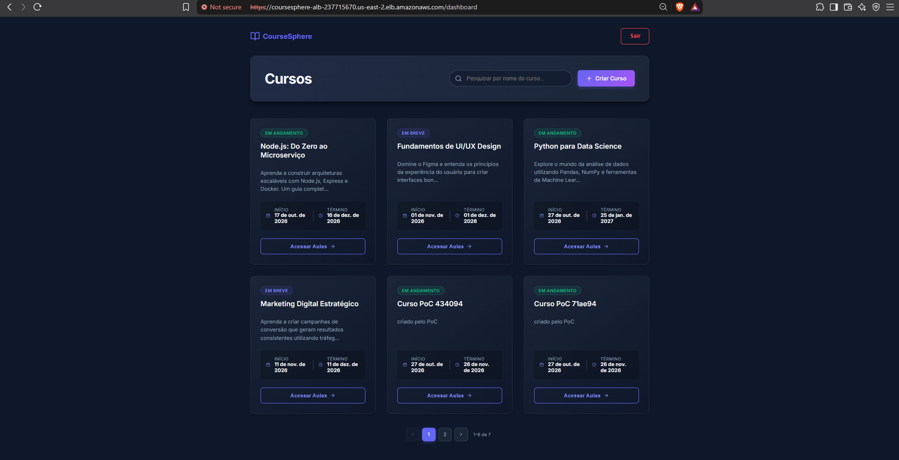
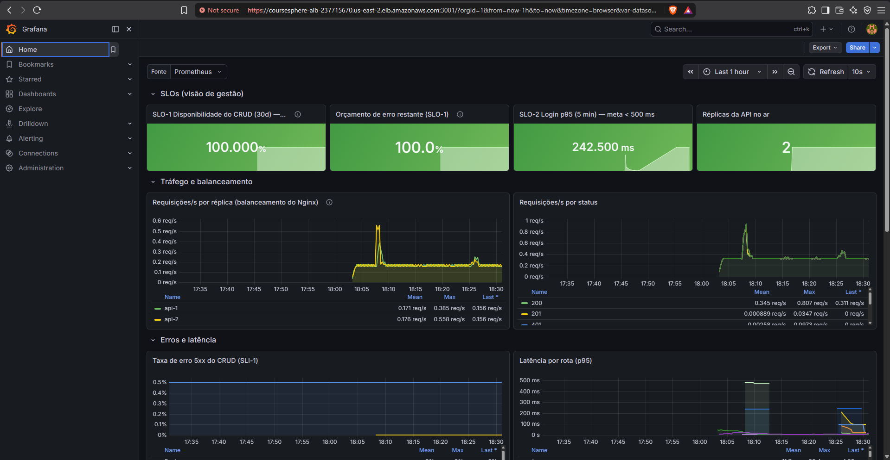
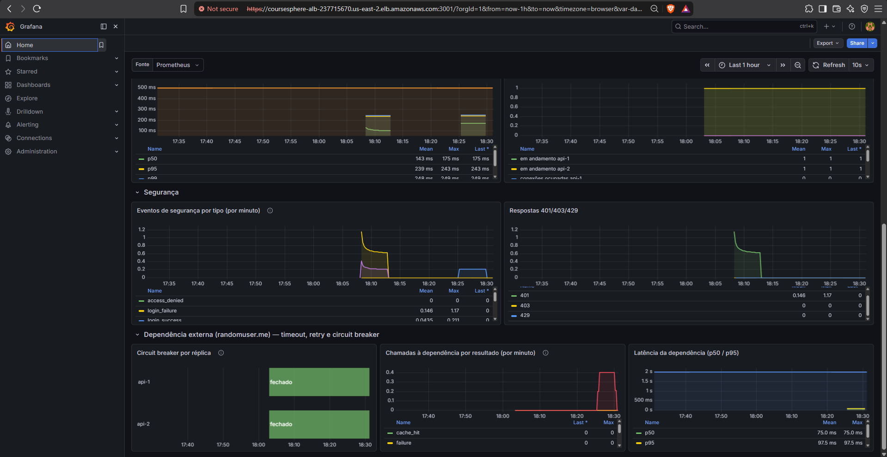

# Evidências: deploy real na AWS

Execução de **28/10/2026** em `us-east-2`, com o Terraform de [`deploy/terraform/aws/`](../../../deploy/terraform/aws/):

- **Commit publicado:** `efb938972537` (versão corrigida da `main`).
- **Instância:** `m7i-flex.large`.
- **Coleta:** só consultas de leitura, pela AWS CLI e pelo SSM Run Command.
- **Mascarado:** o número da conta e o IP autorizado aparecem mascarados, e os tokens JWT foram removidos.
- **Destruição:** o ambiente foi destruído logo depois, às 21:31–21:34 UTC. A conferência de que nada sobrou está em [`destroy.txt`](destroy.txt).

| O que prova | Resultado | Arquivo |
|---|---|---|
| **Rede privada** | instância **sem IP público** e **sem chave SSH**. A sub-rede privada sai para a internet só pelo NAT; a rota para o Internet Gateway existe só nas sub-redes públicas. Nenhuma sub-rede atribui IP público | [`instancia.json`](instancia.json), [`rede-subredes-e-rotas.json`](rede-subredes-e-rotas.json) |
| **Entrada restrita** | ALB: 443 e 3001 só de `x.x.x.x/32`. Instância: 8080 e 3001 só do security group do ALB. Saída da instância: 443 e 80 | [`security-groups.json`](security-groups.json) |
| **Só HTTPS** | TLS 1.3 negociado, política `ELBSecurityPolicy-TLS13-1-2-2021-06`, cabeçalhos inválidos descartados. Porta 80 sem resposta. `/api/metrics` responde 404 na borda | [`alb.json`](alb.json), [`https-headers-e-borda.txt`](https-headers-e-borda.txt) |
| **IAM com privilégio mínimo** | `iam simulate-principal-policy` no papel da instância: **só** `GetSecretValue` no próprio segredo é `allowed`. Outro segredo, `PutSecretValue`, `ListSecrets`, S3, EC2 e IAM dão `implicitDeny` | [`iam-papel-da-instancia.json`](iam-papel-da-instancia.json) |
| **Gestão de segredos** | segredo no Secrets Manager (o valor nunca é lido na coleta). O `.env` foi montado no boot com permissão `-rw-------` (root). Os valores não ficam no state do Terraform (atributo *write-only*) | [`segredo-metadados.json`](segredo-metadados.json), [`instancia-por-dentro-ssm.txt`](instancia-por-dentro-ssm.txt) |
| **Metadados protegidos** | dentro da instância: IMDSv2 responde 200 e IMDSv1 (sem token) é recusado com 401. **Um container não alcança o IMDS** (hop limit 1) | [`instancia-por-dentro-ssm.txt`](instancia-por-dentro-ssm.txt) |
| **Correções valendo na nuvem** | PoC contra o ALB: as **9 vulnerabilidades CORRIGIDO** e o IDOR PROTEGIDO (`--expect fixed`, saída 0) | [`poc-versao-corrigida.txt`](poc-versao-corrigida.txt), [`poc-versao-corrigida.json`](poc-versao-corrigida.json) |
| **Balanceamento** | 40 requisições pelo ALB: **20 na `api-1` e 20 na `api-2`**. O Prometheus contou 106 e 105 requisições por réplica | [`balanceamento-lb-demo.txt`](balanceamento-lb-demo.txt), [`instancia-por-dentro-ssm.txt`](instancia-por-dentro-ssm.txt) |
| **Serviços e observabilidade** | os 8 serviços do compose no ar, com API, banco, frontend e balanceador `healthy`. O Prometheus coleta as 2 réplicas. O Grafana 12.4.13 está saudável pelo ALB | [`instancia-por-dentro-ssm.txt`](instancia-por-dentro-ssm.txt), [`https-headers-e-borda.txt`](https-headers-e-borda.txt) |
| **Cabeçalhos de segurança** | CSP, HSTS, `X-Frame-Options: DENY`, `nosniff`, `Referrer-Policy`, `Permissions-Policy` e COOP chegam pela AWS | [`https-headers-e-borda.txt`](https-headers-e-borda.txt) |
| **Auditoria e administração** | VPC Flow Logs `ACTIVE` (todo o tráfego). Instância `Online` no SSM: administração sem SSH | [`vpc-flow-logs.json`](vpc-flow-logs.json), [`ssm-instancia.json`](ssm-instancia.json) |

## Linha do tempo (UTC)

| Horário | Evento |
|---|---|
| 20:54 | Primeira criação. O plano gratuito da AWS recusou a `t3.medium` (*"not eligible for Free Tier"*, no CloudTrail). Rede, ALB, IAM e segredo já tinham sido criados |
| 20:59 | Instância `m7i-flex.large` criada (o mesmo Terraform, só com outro tipo de instância) |
| 21:02 | Bootstrap concluído: Docker, código do commit, `.env` a partir do Secrets Manager e `docker compose up --build` |
| 21:03 | ALB marca a aplicação e o Grafana como saudáveis |
| 21:08–21:10 | Coleta destas evidências |
| 21:30 | Login na aplicação e no Grafana pelo navegador, com as senhas lidas do Secrets Manager (prints abaixo) |
| 21:31–21:34 | `terraform destroy`: instância, ALB, certificado, segredo, NAT, IP elástico, VPC, papéis IAM e grupo de log apagados. O state ficou vazio e nenhum recurso do projeto restou ([`destroy.txt`](destroy.txt)) |

## Prints

_Aplicação na AWS, logada com o usuário de demonstração, na URL do ALB. O navegador mostra "Not secure" porque o certificado do ALB é autoassinado (sem domínio próprio). Os cursos "Curso PoC" foram criados pelo próprio PoC._

_Grafana servido pelo ALB na porta 3001: SLO-1 em 100%, orçamento de erro intacto, p95 do login em 242,5 ms (meta < 500 ms), 2 réplicas no ar, e as linhas da `api-1` e da `api-2` juntas no painel de balanceamento._

_Eventos de segurança gerados pelo PoC (falhas de login e respostas 401) e a dependência externa com o circuit breaker fechado nas duas réplicas._

## Gate de IaC

O `trivy config` (o mesmo gate do CI: HIGH e CRITICAL bloqueiam) não tem pendências no Terraform da AWS. Os dois achados que são escolhas do desenho estão justificados em [`.trivyignore.yaml`](../../../.trivyignore.yaml):

- ALB público (AWS-0053), restrito a um IP e só com HTTPS;
- saída da instância para qualquer destino em 443/80 (AWS-0104), porque o security group não filtra por domínio.

Os dois achados LOW (chave KMS própria para o segredo e para os logs) ficam como recomendação no [README do Terraform](../../../deploy/terraform/aws/README.md#limites-desta-demonstração-e-o-que-muda-em-produção).
