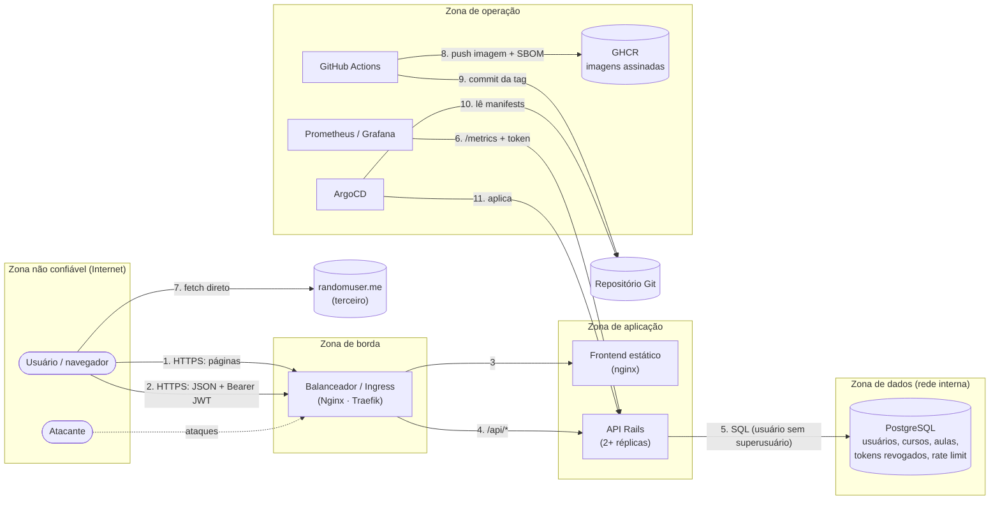

# Modelagem de ameaças (STRIDE)

## 1. Diagrama de fluxo de dados (DFD)

**Fronteiras de confiança:** Internet → borda (TLS, rate limit, headers) · borda → aplicação (só `/` e `/api/*`; `/api/metrics` bloqueado) · aplicação → dados (rede interna, NetworkPolicy) · cadeia de entrega (CI → registry → Git → ArgoCD).

**Ativos:** credenciais e sessões (JWT), conteúdo dos cursos (incl. rascunhos não publicados), dados pessoais (nome, e-mail), disponibilidade do serviço, segredos (`SECRET_KEY_BASE`, senhas do banco, `METRICS_TOKEN`) e integridade das imagens.

## 2. Análise STRIDE

| # | Categoria | Elemento | Ameaça | Controle (status) |
|---|---|---|---|---|
| S1 | **S**poofing | Login | Força bruta / credential stuffing | Rate limit borda + IP + bloqueio por conta; política de senha NIST; alertas (**VULN-03, 09 — corrigido**) |
| S2 | Spoofing | Login | Contas padrão com senha pública | Seeds bloqueados em produção, sem senha padrão (**VULN-04 — corrigido**) |
| S3 | Spoofing | JWT | Token forjado (`alg: none`, chave errada) | Algoritmo fixo, claims obrigatórias, chave derivada (**hardening**) |
| S4 | Spoofing | JWT | Reuso de token roubado após logout | `jti` + lista de revogação (**VULN-02 — corrigido**); cookie HttpOnly (**R6, aberto**) |
| T1 | **T**ampering | API cursos/aulas | Editar recurso de outro usuário (IDOR) | `authorize_creator!` (**já correto**, testado) |
| T2 | Tampering | Aulas | Armazenar `javascript:` em `video_url` | Allowlist http/https no backend + render seguro (**VULN-06 — corrigido**) |
| T3 | Tampering | Imagens/deploy | Imagem adulterada no registry ou dependência maliciosa | Actions por SHA, ferramentas com SHA-256, gate Trivy, assinatura cosign, Kyverno restringe registries, Dependabot com cooldown (**hardening**) |
| R1 | **R**epudiation | Ações sensíveis | Não haver registro de quem fez o quê | Logs JSON com `user_id`, `request_id`, IP; eventos de segurança (**implementado**). Retenção/imutabilidade de logs (**recomendação**) |
| I1 | **I**nformation disclosure | Aulas | Rascunhos lidos por qualquer usuário | `Lesson.visible_to` em toda leitura (**VULN-01 — corrigido**) |
| I2 | Information disclosure | API | Stack traces, `/rails/info` | Produção, erros genéricos (**VULN-05 — corrigido**) |
| I3 | Information disclosure | Login | Enumeração de e-mails pelo tempo de resposta | `authenticate_by` (**VULN-08 — corrigido**); cadastro ainda revela (**residual**, R8) |
| I4 | Information disclosure | Métricas | `/metrics` público | Token + bloqueio na borda (**hardening**) |
| I5 | Information disclosure | Logs | PII e tokens em log | Sem query string, e-mail como hash, `filter_parameters` (**implementado**) |
| D1 | **D**enial of service | Login | Inundação de logins (bcrypt usa CPU de propósito) | Rate limit, HPA, alerta (**mitigado**) |
| D2 | Denial of service | `GET /courses` | Resposta sem paginação cresce sem limite | **Aberto** (R5) |
| D3 | Denial of service | Banco | Instância única | Readiness, timeouts (**parcial**); banco gerenciado HA (**R1**) |
| D4 | Denial of service | API | Payloads enormes | `client_max_body_size 1m`, limites de tamanho nos campos (**implementado**) |
| E1 | **E**levation of privilege | Container | Fuga/escalada a partir do container | Non-root, rootfs read-only, drop ALL, no-new-privileges, Pod Security restricted (**implementado**) |
| E2 | Elevation of privilege | Banco | API comprometida vira dono do servidor de banco | Usuário de app sem superusuário; NetworkPolicy só API → banco (**implementado**) |
| E3 | Elevation of privilege | Cluster | Pod usar a API do Kubernetes | Sem token de service account, NetworkPolicy default-deny (**implementado**) |

## 3. Riscos aceitos / abertos

- **Banco único (D3)** e **sem paginação (D2)**: aceitos no laboratório e priorizados nas recomendações.
- **Token em `localStorage` (S4)**: aceito com revogação + CSP restritiva. Migrar para cookie `HttpOnly` (R6).
- **Enumeração pelo cadastro (I3)**: mitigada por rate limit; resolução completa com confirmação de e-mail (R8).
